# Domain-Specific RAG Assistant

[](https://www.python.org/)
[](https://fastapi.tiangolo.com/)
[](https://streamlit.io/)
[](https://qdrant.tech/)
[](https://build.nvidia.com/)
[](https://docs.pytest.org/)
[](https://www.docker.com/)

A production-grade, domain-configurable **Retrieval-Augmented Generation (RAG)** assistant designed for high-fidelity document question answering. The system ingests **digital PDFs, scanned documents, embedded infographics/tables, standalone images (`.png`, `.jpg`), Word documents, and Markdown**, constructs section-aware vector embeddings, and delivers strictly **grounded, page-cited responses** with real-time observability and context-sufficiency safeguards.

---

## 1. Project Overview

General-purpose Large Language Models (LLMs) hallucinate or produce generic answers when queried about domain-specific policies, proprietary manuals, or detailed procedures. Simply feeding an entire document library into an LLM context window is cost-prohibitive, slow, and prone to context degradation.

**Domain-Specific RAG Assistant** bridges this gap through a high-precision context engineering pipeline:

- **Multi-Modal Document Ingestion**: Ingests pure digital text, scanned image pages, and mixed pages containing embedded tables/charts using PyMuPDF and **NVIDIA NIM Vision OCR** (`meta/llama-3.2-11b-vision-instruct`), with an on-device **RapidOCR fallback**.
- **Section-Aware Chunking**: Preserves heading hierarchies (`section_id`, `section_heading`, `section_chunk_index`) and propagates section boundaries across multi-page document spans.
- **Deterministic Vector Indexing**: Computes 2,048-dimensional dense embeddings via **NVIDIA Nemotron-3-Embed-1B** and indexes them into **Qdrant** with deterministic UUID5 point IDs.
- **Heading-Aware Section Retrieval**: When users query section titles (e.g., *"SECTION C — 20 Ways to Make Money Using AI"*), the system identifies the section intent, scrolls all contiguous section chunks across page ranges, and bypasses artificial top-$k$ cutoffs.
- **Strict Grounding & Traceability**: System prompts enforce source attribution by document name and page number. If the retrieved context is insufficient or scores below the threshold ($0.15$), the model explicitly declines to answer rather than fabricating facts.
- **Full Observability**: Live tracking of retrieval latency, LLM latency, input/output token counts, similarity scores, and cost estimates.

```
┌─────────────────────────────────────────────────────────────────────────────────┐
│ Quick Summary: Ingests PDFs & images → Extracts text & embedded tables via OCR  │
│ → Indexes into Qdrant → Performs heading-aware hybrid retrieval                 │
│ → Generates grounded, cited answers with zero hallucinations.                  │
└─────────────────────────────────────────────────────────────────────────────────┘
```

---

## 2. Problem Statement — 🤔 PROBLEM

Standard RAG implementations routinely fail when deployed on real-world enterprise documents due to five fundamental engineering bottlenecks:

1. **Information Loss on Mixed PDF Pages**: Many PDFs combine digital text headers with complex tables, charts, or slides embedded as rasterized images. Naive loaders that check `if len(digital_text) > threshold` skip OCR entirely, discarding critical tabular data.
2. **Scanned & Image-Only Content**: Scanned contracts, invoices, and screenshot slides lack extractable digital text layers and require high-resolution optical character recognition (OCR) that preserves columnar layouts.
3. **Loss of Heading-to-Content Relationships**: Fixed-size token chunking splits headings away from their associated body text or fragments numbered lists across arbitrary chunk boundaries.
4. **Section-Title Query Blindness**: Standard dense semantic search evaluates similarity between the complete question and single chunks. When a user asks for an entire section (e.g., a chapter containing 20 numbered items spread across 7 pages), semantic similarity retrieves only the Table of Contents or a random subset of items because $top\_k$ is typically capped at 3–5.
5. **Hallucinations & Untraceable Claims**: Vanilla LLMs invent missing steps or extrapolate facts without providing exact document page citations.

### Problem Scope: Designed vs. Tested

| Problem Dimension | Designed Scope | Verified & Tested Scope |
|---|---|---|
| **Digital PDF Ingestion** | Any standard PDF up to 25 MB | Verified across 42-page technical manuals and ebooks |
| **Mixed Pages (Text + Images)** | Automatic detection of large embedded images | Verified on Pages 24, 26, 27, 28, 37 of test PDF |
| **Scanned Document Extraction** | Hybrid OCR via Vision LLM + Local RapidOCR | Verified on synthetic image PDFs and real PNG table screenshots |
| **Section-Title Retrieval** | Multi-page section boundary propagation | Verified retrieving all 20 sequential methods across Pages 17–23 |
| **Format Support** | `.pdf`, `.docx`, `.txt`, `.md`, `.png`, `.jpg`, `.jpeg`, `.webp`, `.bmp`, `.tiff` | Verified across PDF, TXT, DOCX, and PNG formats |

---

## 3. Proposed Solution — 🧑‍💻 SOLUTION

The application implements a 14-stage context-engineering and retrieval pipeline:

```mermaid
flowchart TD
    subgraph INGESTION ["Document Ingestion Pipeline"]
        A[User uploads Document / Image] --> B[File Validation & Extension Check]
        B --> C{File Type?}
        C -->|PDF| D[PyMuPDF Page Iteration]
        C -->|Image: PNG/JPG| E[Hybrid OCR Vision Engine]
        C -->|DOCX / TXT / MD| F[Native Text Extractor]
        D --> G{Has Digital Text & Images?}
        G -->|Pure Digital| H[Extract Layout Blocks & Digital Tables]
        G -->|Mixed Page| I[Extract Embedded Images & Run Vision OCR]
        G -->|Scanned / Empty| J[Render High-DPI Pixmap & Run OCR]
        I --> K[Merge Digital Text + OCR Tables]
        J --> K
        H --> K
        E --> K
        F --> K
        K --> L[Text Cleaner: Unicode Dash & Hyphen Repair]
        L --> M[Section-Aware Chunker: Hierarchy & Boundaries]
        M --> N[Embedding Generator: Nemotron-3-Embed-1B]
        N --> O[(Qdrant Vector Database: Payload & Vectors)]
    end

    subgraph RETRIEVAL ["Question Answering & Retrieval Pipeline"]
        P[User Query] --> Q[Query Understanding & Section Intent Detection]
        Q --> R[Dense Vector Search in Qdrant]
        Q --> S{Is Section Query?}
        S -->|Yes| T[get_section_chunks: Sequential Scroll]
        S -->|No| U[Standard Candidate Pool]
        T --> V[Merge & Prioritize Section Chunks]
        R --> V
        U --> V
        V --> W[Reranker: Exact Phrase Boost & Sufficiency Filter]
        W --> X[Bounded Context Builder: Attributed Source Blocks]
        X --> Y[Grounded LLM: Llama-3.2-11B-Vision-Instruct]
        Y --> Z[Grounded Answer + Page-Level Citations + Observability]
    end
```



### Detailed Pipeline Stages

1. **Document Upload**: Multi-file ingestion via FastAPI `POST /upload` or the Streamlit web interface.
2. **Validation**: Safe filename normalization (preventing path traversal) and file size validation (default $25\text{ MB}$).
3. **Digital Extraction**: PyMuPDF extracts text layout blocks and structured table blocks (`page.find_tables()`).
4. **Hybrid OCR for Scanned Pages & Embedded Images**: 
   - Detects embedded images covering $\ge 10\%$ of page area.
   - Dispatches images to **NVIDIA NIM Vision** (`meta/llama-3.2-11b-vision-instruct`) with a Markdown table transcription prompt.
   - Falls back to local **RapidOCR (ONNX)** when offline or vision credentials are unavailable.
5. **Text Cleaning**: Normalizes Unicode punctuation (em-dashes `\u2014`, en-dashes `\u2013`, minus signs), repairs hyphenated line wraps, removes isolated page numbers, and joins multi-line section titles split across line breaks.
6. **Section-Aware Chunking**: Token-bounded chunking (configurable 500–800 tokens, 50–100 token overlap) that assigns `section_id`, `section_heading`, `subsection_heading`, and `section_chunk_index` metadata to every chunk, propagating section boundaries across multi-page document spans.
7. **Embedding Generation**: Batch embedding generation with dimension validation ($2,048$ dimensions).
8. **Qdrant Storage**: Deterministic UUID5 point IDs prevent duplicate chunks on re-upload; point payloads store rich metadata for filtering.
9. **Query Understanding**: Analyzes question intent, extracts key search phrases, and detects section patterns (`SECTION [A-Z]`, `Chapter \d+`).
10. **Vector & Section Retrieval**: Dense cosine similarity search combined with target section chunk scrolling (`store.get_section_chunks`).
11. **Filtering & Reranking**: Applies a similarity floor (`MIN_SIMILARITY=0.10`), boosts exact keyword phrase matches, preserves all sequential chunks of a matched section (up to 25 chunks), and validates sufficiency (`SUFFICIENCY_THRESHOLD=0.15`).
12. **Context Assembly**: Constructs token-bounded context blocks formatted with document name, page number, and section title tags.
13. **Grounded Generation**: Generates responses using `meta/llama-3.2-11b-vision-instruct` (or OpenAI/Modal fallbacks) governed by strict system prompt grounding rules.
14. **Attribution & Telemetry**: Emits structured source citations (`document`, `page`, `chunk_id`, `score`) and telemetry (latency, token usage, cost).

---

## 4. Key Features

| Feature | Description | Status | Source File |
|---|---|---|---|
| **Digital PDF Ingestion** | Page-by-page digital text & table layout extraction | ✅ Verified | [`app/ingestion/loader.py`](app/ingestion/loader.py) |
| **Embedded Image Table OCR** | Transcribes charts, slides & tables inside PDF pages | ✅ Verified | [`app/ingestion/loader.py`](app/ingestion/loader.py) |
| **Standalone Image Ingestion** | Direct upload & OCR for `.png`, `.jpg`, `.jpeg`, `.webp` | ✅ Verified | [`app/ingestion/loader.py`](app/ingestion/loader.py) |
| **Local OCR Fallback** | RapidOCR ONNX fallback when Vision API is offline | ✅ Verified | [`app/ingestion/loader.py`](app/ingestion/loader.py) |
| **Section Boundary Tracking** | Propagates headings across multi-page chapters | ✅ Verified | [`app/ingestion/chunker.py`](app/ingestion/chunker.py) |
| **Heading-Aware Section Retrieval** | Retrieves complete multi-chunk sections in sequence | ✅ Verified | [`app/retrieval/retriever.py`](app/retrieval/retriever.py) |
| **Exact Keyword Phrase Boosting** | Boosts candidate ranking on exact term matches | ✅ Verified | [`app/retrieval/reranker.py`](app/retrieval/reranker.py) |
| **Context Sufficiency Check** | Rejects queries when context similarity is below threshold | ✅ Verified | [`app/retrieval/reranker.py`](app/retrieval/reranker.py) |
| **Page-Level Source Citations** | Returns exact document name, page, and chunk metadata | ✅ Verified | [`app/rag/answer_generator.py`](app/rag/answer_generator.py) |
| **Document Inspector Modal** | UI inspector for page-by-page text & section hierarchy | ✅ Verified | [`frontend/app.py`](frontend/app.py) |
| **Duplicate Document Cleanup** | UI and API detection and removal of duplicate uploads | ✅ Verified | [`frontend/app.py`](frontend/app.py) |
| **Real-time Observability** | Ring-buffer metrics for latency percentiles and token usage | ✅ Verified | [`app/observability/metrics_store.py`](app/observability/metrics_store.py) |
| **Modal Cloud Inference** | Serverless LLM hosting option via Modal | ⚠️ Implemented (Optional) | [`modal_app.py`](modal_app.py) |
| **Sparse BM25 Indexing** | Built-in Qdrant sparse vectors for hybrid RRF | 📋 Planned | Roadmap |

---

## 5. Technology Stack — 🧑‍🔧 TECHNOLOGY

| Technology | Version / Model | Purpose | Why It Was Chosen |
|---|---|---|---|
| **Python** | `>=3.10` | Core Application Runtime | Industry standard for AI, RAG pipelines, and data processing. |
| **FastAPI** | `>=0.110` | REST API Layer | High-performance asynchronous API framework with automatic OpenAPI docs and Pydantic validation. |
| **Streamlit** | `>=1.33` | Interactive Web UI | Rapid reactive user interface for document management, chat, inspection, and telemetry. |
| **PyMuPDF (fitz)** | `>=1.24` | PDF Parsing & Rendering | Fast C-backed PDF engine capable of extracting text blocks, table bounding boxes, and rendering high-DPI pixmaps. |
| **RapidOCR (ONNX)** | `>=1.4.0` | Local OCR Engine | Lightweight, cross-platform OCR running on CPU via ONNX Runtime without requiring external system dependencies. |
| **Qdrant** | `>=1.9` | Vector Database | High-performance vector engine supporting payload filtering, cosine distance, deterministic point updates, and local disk persistence. |
| **NVIDIA NIM (Embeddings)** | `nemotron-3-embed-1b` | Dense Vector Representation | High-accuracy 2,048-dimensional dense embedding model tailored for enterprise retrieval benchmarks. |
| **NVIDIA NIM (LLM)** | `meta/llama-3.2-11b-vision-instruct` | Multimodal Vision OCR & Answer Generation | Fast, instruction-tuned vision-language model with 128k context support, sub-3s short-query latency, and high-fidelity table extraction. |
| **Pydantic** | `>=2.6` | Data Validation & Settings | Strict runtime schema validation and environment variable parsing via `pydantic-settings`. |
| **Pytest** | `>=8.0` | Automated Test Suite | Comprehensive testing framework verifying all unit, integration, and end-to-end RAG workflows. |
| **uv** | Latest | Environment & Package Manager | Extremely fast Rust-based Python package resolver and runner. |

---

## 6. System Architecture

### Component Breakdown

1. **API Router Layer (`app/api/`)**:
   - `routes_upload.py`: Handles multi-part file uploads, security validation, and triggers indexing.
   - `routes_query.py`: Orchestrates query cleaning, retrieval, context building, and answer generation.
   - `routes_documents.py`: Manages document listing, deletion, and the deep inspection modal.
   - `routes_metrics.py`: Exposes system health checks and sliding-window performance telemetry.
2. **Ingestion Engine (`app/ingestion/`)**:
   - `loader.py`: Inspects PDF pages for digital text and embedded images; coordinates Vision and RapidOCR.
   - `cleaner.py`: Standardizes dashes, joins split titles across line breaks, and removes isolated page numbers.
   - `chunker.py`: Builds hierarchical chunks, associating section titles with sequential child chunks.
   - `indexer.py`: Embeds chunks in batches and upserts them into Qdrant using deterministic UUID5 point IDs.
3. **Retrieval Engine (`app/retrieval/`)**:
   - `query_understanding.py`: Parses query intent, identifies target sections, and extracts phrases.
   - `retriever.py`: Executes dense search and triggers section scrolling when section intent is detected.
   - `reranker.py`: Applies similarity filters, exact-phrase boosting, and ensures sequential multi-chunk preservation.
   - `context_builder.py`: Formats chunk context with source metadata tags within the `MAX_CONTEXT_CHARS` budget.
4. **Model Providers (`app/llm/` & `app/vectorstore/`)**:
   - `nvidia_provider.py`: Connects to NVIDIA NIM completions with configurable timeouts, fallbacks, and token caps.
   - `qdrant_store.py`: Wraps Qdrant Client; supports both remote Qdrant servers and local disk storage (`qdrant_storage/`).

---

## 7. Repository Structure

```text
Domain-Specific-RAG-Application/
├── app/
│   ├── __init__.py
│   ├── main.py                     # FastAPI application entry point
│   ├── api/                        # API route controllers & Pydantic schemas
│   │   ├── routes_documents.py     # Document list, delete, and inspect endpoints
│   │   ├── routes_metrics.py       # Metrics and health check endpoints
│   │   ├── routes_query.py         # RAG question-answering endpoint
│   │   ├── routes_upload.py        # Document upload and ingestion endpoint
│   │   └── schemas.py              # Request and response models
│   ├── core/                       # Core configuration, security, and logging
│   │   ├── config.py               # Pydantic Settings loaded from .env
│   │   ├── logging_config.py       # Structured JSON logging setup
│   │   └── security.py             # File extension, size, and filename sanitization
│   ├── ingestion/                  # Document parsing and chunking pipeline
│   │   ├── chunker.py              # Section-aware token chunking and boundary propagation
│   │   ├── cleaner.py              # Unicode dash normalization and text cleaning
│   │   ├── indexer.py              # Batch embedding generation and vector DB indexing
│   │   └── loader.py               # Hybrid PDF, image, and document text extraction
│   ├── llm/                        # LLM provider abstractions and integrations
│   │   ├── base.py                 # Abstract BaseLLM and LLMResponse dataclasses
│   │   ├── factory.py              # Provider factory (NVIDIA, OpenAI, Anthropic, Modal)
│   │   ├── modal_provider.py       # Modal serverless LLM provider
│   │   ├── nvidia_provider.py      # NVIDIA NIM chat completions provider
│   │   └── openai_provider.py      # OpenAI provider implementation
│   ├── observability/              # Telemetry and metrics tracking
│   │   └── metrics_store.py        # In-memory metrics ring buffer
│   ├── rag/                        # End-to-end RAG synthesis
│   │   ├── answer_generator.py     # Prompt formatting, LLM call, and source parsing
│   │   ├── pipeline.py             # Pipeline orchestrator
│   │   └── prompts.py              # Prompt template loaders
│   ├── retrieval/                  # Search and context assembly
│   │   ├── context_builder.py      # Structured, token-bounded context construction
│   │   ├── query_understanding.py  # Intent detection, phrase extraction, dash normalization
│   │   ├── reranker.py             # Similarity filtering, phrase boosting, section preservation
│   │   └── retriever.py            # Dense search and section candidate expansion
│   └── vectorstore/                # Vector database drivers
│       ├── base.py                 # VectorStore interface and Point dataclass
│       ├── factory.py              # Vector store factory
│       ├── pinecone_store.py       # Pinecone integration alternative
│       └── qdrant_store.py         # Qdrant client driver (remote and local storage)
├── frontend/                       # Interactive web UI
│   └── app.py                      # 4-tab Streamlit application
├── data/                           # Storage directories
│   ├── documents/                  # Persistent store for uploaded documents
│   └── sample_documents/           # Sample test documents
├── prompts/                        # Versioned prompt templates
│   ├── answer_prompt.txt           # RAG context framing template
│   └── rag_system_prompt.txt       # Strict grounding and citation system instructions
├── tests/                          # Automated test suite (43 tests in tests/)
│   ├── test_comprehensive_rag.py   # Multi-modal PDF ingestion, OCR, and RAG tests (13)
│   ├── test_section_retrieval.py   # Heading detection, section bounds, and chunk expansion (6)
│   ├── test_image_extraction.py    # Direct image OCR and table validation tests (3)
│   ├── test_api.py                 # FastAPI endpoints, metrics, and health tests (5)
│   ├── test_nvidia_embeddings.py   # Embedding validation, dimension, and redaction (7)
│   ├── test_rag.py                 # Prompt templates, grounded answering, and citations (3)
│   ├── test_retrieval.py           # Deduplication, thresholding, and formatting (3)
│   └── test_ingestion.py           # Text cleaning, whitespace, and pagination tests (3)
├── test_modal_llm.py               # Modal serverless LLM and pipeline tests (7)
├── .env.example                    # Template for environment variables
├── docker-compose.yml              # Multi-container orchestration (Qdrant + App + UI)
├── Dockerfile                      # Application container definition
├── modal_app.py                    # Modal cloud serverless endpoint definition
├── pyproject.toml                  # Project metadata, dependencies, and pytest configuration
├── requirements.txt                # Pinned pip requirements
└── README.md                       # Master documentation
```

---

## 8. Installation and Setup Instructions

### Prerequisites

- **Python**: Version `3.10` or higher (verified on Python 3.12).
- **Package Manager**: [`uv`](https://docs.astral.sh/uv/) (recommended) or `pip`.
- **NVIDIA NIM API Key**: Required for Nemotron embeddings and Llama-3.2 vision/language inference (get one at [build.nvidia.com](https://build.nvidia.com/)).

### Step-by-Step Setup

#### 1. Clone the Repository
```bash
git clone https://github.com/your-username/domain-specific-rag-application.git
cd domain-specific-rag-application
```

#### 2. Create and Activate a Virtual Environment
```bash
# Using uv (fastest)
uv venv
# Windows:
.venv\Scripts\activate
# Linux/macOS:
source .venv/bin/activate
```

#### 3. Install Dependencies
```bash
# Using uv
uv pip install -r requirements.txt

# Or using standard pip
pip install -r requirements.txt
```

#### 4. Configure Environment Variables
Copy the example environment template and configure your credentials:
```bash
cp .env.example .env
```

Edit `.env` with your settings:
```dotenv
# ---- Domain Configuration ----
DOMAIN_NAME=Company Policy Assistant

# ---- LLM Configuration (NVIDIA NIM) ----
LLM_PROVIDER=nvidia
LLM_MODEL=meta/llama-3.2-11b-vision-instruct
LLM_FALLBACK_MODEL=openai/gpt-oss-20b
LLM_TIMEOUT=120
LLM_MAX_TOKENS=2500
LLM_TEMPERATURE=0.2

# ---- Embeddings (NVIDIA NIM) ----
EMBEDDING_PROVIDER=nvidia
NVIDIA_API_KEY=your_actual_nvidia_api_key_here
NVIDIA_MODEL=nemotron-3-embed-1b
NVIDIA_BASE_URL=https://integrate.api.nvidia.com/v1
EMBEDDING_DIM=2048

# ---- Vector Database (Qdrant) ----
VECTOR_PROVIDER=qdrant
QDRANT_URL=http://localhost:6333
QDRANT_API_KEY=
QDRANT_COLLECTION=rag_documents

# ---- Retrieval & Chunking ----
CHUNK_SIZE=500
CHUNK_OVERLAP=50
TOP_K=5
RETRIEVAL_CANDIDATES=12
MIN_SIMILARITY=0.10
SUFFICIENCY_THRESHOLD=0.15
MAX_CONTEXT_CHARS=16000

# ---- Ingestion & OCR ----
OCR_ENGINE=auto
OCR_DEFAULT_DPI=150
OCR_HIGH_DPI=250
OCR_TRIGGER_CHAR_THRESHOLD=40

# ---- File Uploads ----
MAX_UPLOAD_MB=25
ALLOWED_EXTENSIONS=.pdf,.txt,.md,.docx,.png,.jpg,.jpeg,.webp,.bmp,.tiff
DOCUMENTS_DIR=data/documents

# ---- Frontend Connection ----
API_URL=http://localhost:8000
```

> [!NOTE]
> If a local Qdrant server is not running on port `6333`, the application **automatically falls back to local disk storage** in `qdrant_storage/`, requiring no Docker setup for standalone local use.

---

### Running the Application

#### Option A: Single Command Quickstart (Recommended)
```powershell
python run.py
```
- Automatically initializes and supervises the FastAPI backend on `http://127.0.0.1:8000`.
- Launches and connects the Streamlit Web UI on `http://localhost:8501`.

#### Option B: Running Locally with Two Terminals

**Terminal 1 — Start the FastAPI Backend:**
```powershell
uv run uvicorn app.main:app --host 0.0.0.0 --port 8000 --reload
```
- API Base: `http://localhost:8000`
- Interactive OpenAPI Docs: `http://localhost:8000/docs`

**Terminal 2 — Start the Streamlit Web UI:**
```powershell
uv run streamlit run frontend/app.py --server.port 8501
```
- Web Application: `http://localhost:8501`

#### Option C: Running with Docker Compose
```bash
docker compose up --build
```
- Backend: `http://localhost:8000/docs`
- Frontend: `http://localhost:8501`
- Qdrant: `http://localhost:6333/dashboard`

---

## 9. Usage Guide

### Complete End-to-End Workflow

1. **Access the Web Interface**: Navigate to `http://localhost:8501`.
2. **Upload Documents**:
   - Open the **Upload & Index Documents** tab.
   - Drag and drop your files (`.pdf`, `.png`, `.jpg`, `.docx`, etc.).
   - Click **Ingest & Index Document(s)**.
   - The live progress bar will track document parsing, OCR table transcription, chunking, and vector embedding.
3. **Inspect Document Chunks & Hierarchy**:
   - Navigate to the **Document Index Manager** tab.
   - Click **Inspect Document** next to any indexed file.
   - Review page character counts, detected section hierarchies (e.g., Section ID, Heading, Page Range), and raw chunk payloads.
4. **Query the Assistant**:
   - Open the **Query Assistant** tab and ask a question.
   - View the grounded answer, context sufficiency badge, expandable source citations with exact page numbers, and real-time execution latency.

### Verified Example Questions

You can test these real queries against indexed documents:

| Query Type | Example Query | Expected Behavior |
|---|---|---|
| **Specific Section Retrieval** | `"SECTION C — 20 Ways to Make Money Using AI (No Skills Needed)"` | Retrieves all 7 contiguous chunks across Pages 17–23 and enumerates all 20 methods sequentially. |
| **Heading / Exact Subtitle** | `"The Only 3 Things You Need to Start"` | Pinpoints Page 11 and cites the 3 exact accounts (ChatGPT, Canva, Gumroad/Fiverr) with URLs. |
| **Embedded Image Table Query** | `"What tools are listed in Section D for building and monetizing skills?"` | Extracts the table on Page 24 and lists all 13 tools with their roles, method mappings, and free tiers. |
| **Standalone Image Query** | `"From the AI Tools table, what does Claude do and is there a free tier?"` | Retrieves content from `AI_Tools_and_Skills_Table.png` (Page 1) and states role and `claude.ai` URL. |
| **Out-of-Scope Query** | `"What is the company's policy on international business travel?"` (when not in document) | Flags `sufficient_context: false` and responds: *"The available documents do not provide sufficient information to answer this reliably."* |

---

## 10. Screenshots and UI Walkthrough

*(Recommended screenshots to capture from the running Streamlit interface on port 8501)*

### 1. Query Assistant Tab
`docs/screenshots/chat_query_view.png`
*Displays the conversational interface, grounded answer generation, expandable source citation drawers showing document names, page numbers, and similarity scores, and execution metrics.*

### 2. Document Upload & Ingestion
`docs/screenshots/document_upload_progress.png`
*Displays multi-file selection (`.pdf`, `.png`, `.docx`), live progress bar, and the ingestion summary table showing extracted page counts, digital vs. OCR breakdown, and chunk counts.*

### 3. Document Index Manager & Inspector Modal
`docs/screenshots/document_inspector_modal.png`
*Displays the document management view, duplicate detection alert, duplicate cleanup action, and the deep inspection modal revealing detected section hierarchies and chunk payloads.*

### 4. Observability & Analytics Dashboard
`docs/screenshots/observability_dashboard.png`
*Displays real-time telemetry metrics: P50/P95/P99 latency trends, token consumption graphs, and cost estimates.*

---

## 11. Technical Challenges & Engineering Solutions — 🧑‍🏫 CHALLENGE

### Challenge 1: Heading-Aware Multi-Page Section Retrieval (Bug 2)
- **Problem**: When users queried section titles such as `"SECTION C — 20 Ways to Make Money Using AI"`, the application responded: *"The available documents do not provide sufficient information to list all 20 ways."*
- **Root Cause**:
  1. The heading detection regex broke on em-dashes (`—`) and parenthetical subtitles, failing to recognize the section.
  2. Section C spans **7 pages** (Pages 17–23). With `TOP_K=5`, standard cosine similarity only retrieved the Table of Contents (Page 5) and 2 random pages, delivering only 8 of 20 methods to the LLM.
- **Investigation**: Inspected chunk payloads in Qdrant and discovered that chunks lacked section identity metadata, causing the retriever to treat them as independent fragments.
- **Solution**:
  - Implemented Unicode dash normalization in [`app/ingestion/cleaner.py`](app/ingestion/cleaner.py).
  - Added section hierarchy tracking (`section_id`, `section_heading`, `section_chunk_index`) and boundary propagation in [`app/ingestion/chunker.py`](app/ingestion/chunker.py).
  - Added `get_section_chunks()` in [`app/vectorstore/qdrant_store.py`](app/vectorstore/qdrant_store.py) to scroll and return all chunks belonging to a section in strict sequential order.
  - Added section candidate expansion in [`app/retrieval/retriever.py`](app/retrieval/retriever.py) and multi-chunk preservation (up to 25 chunks) in [`app/retrieval/reranker.py`](app/retrieval/reranker.py).
- **Verification**: Verified live via `/query`. The system retrieved all 7 chunks (Pages 17–23) and enumerated all 20 methods with 100% completeness.

### Challenge 2: Upstream LLM Read Timeouts & Output Token Capping
- **Problem**: Upstream HTTP requests failed with `500 Internal Server Error: Read timed out (45s)` on `openai/gpt-oss-20b`, and long answers were truncated at Item 12.
- **Root Cause**:
  1. `integrate.api.nvidia.com` experienced latency/timeouts on `openai/gpt-oss-20b` when hardcoded to 45s.
  2. `max_tokens` was hardcoded to `1024`, truncating comprehensive 20-item enumerations halfway through generation.
- **Investigation**: Benchmarked model latencies via NVIDIA NIM. `meta/llama-3.2-11b-vision-instruct` responded in sub-3s for short queries and ~39s for 1,000-token prompts.
- **Solution**:
  - Configured `LLM_MODEL=meta/llama-3.2-11b-vision-instruct` with automatic fallback in [`app/llm/nvidia_provider.py`](app/llm/nvidia_provider.py).
  - Made network timeout configurable (`LLM_TIMEOUT=120`).
  - Increased LLM output token budget to `2,500 tokens` (`LLM_MAX_TOKENS=2500`).
- **Verification**: Verified generating 1,993 output tokens in 97s without truncation or timeouts.

### Challenge 3: Omission of Embedded Table Images in Mixed PDFs
- **Problem**: Table images embedded in PDF pages (such as the 13-tool comparison table in Section D) were never extracted or searchable.
- **Root Cause**: The loader checked `if len(digital_text) >= 40: continue`. On Page 24, a 172-character digital heading caused the loader to treat the page as pure digital text, skipping OCR on the embedded table image completely.
- **Investigation**: Inspected image bounding boxes via `page.get_image_rects()`. Discovered that Page 24 had an image covering 27.4% of the page area containing the entire table.
- **Solution**:
  - Implemented significant embedded image detection ($\ge 10\%$ page area or $\ge 80{,}000\text{ pt}^2$) in [`app/ingestion/loader.py`](app/ingestion/loader.py).
  - Extracted embedded images at native stream resolution and processed them through NVIDIA NIM Vision OCR with a Markdown table transcription prompt.
  - Merged extracted table Markdown directly into the page's digital text block.
- **Verification**: Extracted character count on Page 24 jumped from **172 characters to 2,282 characters**. Queries for Section D tools retrieved all 13 tools with exact URLs.

### Challenge 4: Direct Standalone Image Uploads & Character Encoding Crashes
- **Problem**: Users could not upload standalone image files (`.png`, `.jpg`), and local RapidOCR crashed on Windows with `charmap codec can't encode character '\u53e3'`.
- **Root Cause**: `ALLOWED_EXTENSIONS` excluded image formats, and RapidOCR icon glyphs failed default Windows console encoding.
- **Solution**:
  - Added `.png, .jpg, .jpeg, .webp, .bmp, .tiff` across security validation, config, and Streamlit uploader.
  - Implemented direct single-image ingestion in `load_pages_detailed`.
  - Added `_sanitize_ocr_text()` to strip non-printable control characters and normalize output.
- **Verification**: Successfully uploaded `AI_Tools_and_Skills_Table.png`, verified single-image indexing, and queried tool metadata with $0.72$ similarity score.

---

## 12. Results and Evaluation — 🚀 RESULT

Empirical verification executed against the live system and test suite:

### Quantitative Performance Metrics

| Metric | Measured Value | Verification Source |
|---|---|---|
| **Test Suite Pass Rate** | **100% (50 / 50 passed)** | `uv run pytest` (30.26s runtime) |
| **Comprehensive RAG Suite** | **13 / 13 passed** | [`tests/test_comprehensive_rag.py`](tests/test_comprehensive_rag.py) |
| **Section Retrieval Suite** | **6 / 6 passed** | [`tests/test_section_retrieval.py`](tests/test_section_retrieval.py) |
| **Image Extraction Suite** | **3 / 3 passed** | [`tests/test_image_extraction.py`](tests/test_image_extraction.py) |
| **NVIDIA Embeddings Suite** | **7 / 7 passed** | [`tests/test_nvidia_embeddings.py`](tests/test_nvidia_embeddings.py) |
| **Modal LLM Endpoint Suite** | **7 / 7 passed** | [`test_modal_llm.py`](test_modal_llm.py) |
| **API & Metrics Suite** | **5 / 5 passed** | [`tests/test_api.py`](tests/test_api.py) |
| **Core RAG & Ingestion Suite** | **9 / 9 passed** | [`tests/test_rag.py`](tests/test_rag.py), `test_ingestion.py`, `test_retrieval.py` |
| **Page 24 Extraction Fidelity** | **172 chars → 2,282 chars** | Embedded table OCR extraction |
| **Page 26 Extraction Fidelity** | **63 chars → 2,558 chars** | Embedded selling platforms OCR |
| **Section C Retrieval Completeness** | **20 / 20 methods (100%)** | Live Query 2 (Pages 17–23) |
| **Citation Precision** | **100% valid page citations** | Page 11, Page 24, Pages 17–23 |
| **Image Query Similarity** | **0.7212 cosine similarity** | Standalone PNG upload query |
| **Short Query Latency** | **2.63 seconds** | 100-token generation benchmark |
| **Full Section Query Latency** | **97.99 seconds** | 1,993 output tokens (20 full methods) |

---

## 13. Known Limitations

- **Cloud Vision Latency**: Running high-resolution Vision OCR on pages with large embedded images takes 10–15 seconds per image over remote HTTPS connections to NVIDIA NIM.
- **Single-Process Local Storage Lock**: When using local disk Qdrant storage (`qdrant_storage/`), the database directory is locked by the active FastAPI server process. External offline scripts fallback to `:memory:`; all queries should be sent via the HTTP API (`http://localhost:8000`).
- **Very Low DPI Scans**: Scanned images with resolutions below 100 DPI or severe motion blur may produce imperfect OCR transcriptions.

---

## 14. Prioritized Roadmap

- [ ] **Native Sparse BM25 Fusion**: Integrate Qdrant's sparse vector indexing (`fastembed`) alongside dense vectors for hybrid Reciprocal Rank Fusion (RRF).
- [ ] **Multi-Turn Conversational Memory**: Extend the query pipeline to support multi-turn chat sessions with query contextualization.
- [ ] **Role-Based Access Control (RBAC)**: Add user authentication and document-level access permissions.
- [ ] **Asynchronous Task Queue**: Offload heavy PDF OCR processing to Celery or Redis background workers for large batches.

---

## 15. Testing

The repository contains 50 automated unit and integration tests across 9 test modules:

```powershell
# Run the complete test suite across the workspace
uv run pytest

# Run with concise summary
uv run pytest -q

# Run specific test modules
uv run pytest tests/test_comprehensive_rag.py -q
uv run pytest tests/test_section_retrieval.py -q
uv run pytest tests/test_image_extraction.py -q
uv run pytest test_modal_llm.py -q
```

### Test Coverage Highlights

- `test_cleaner_normalizes_unicode_dashes`: Verifies em-dash, en-dash, and minus-sign repair.
- `test_extract_section_header_exact_and_fuzzy`: Verifies heading detection across case and punctuation variations.
- `test_chunk_preserves_section_metadata`: Verifies that chunks retain section IDs, headings, and indexes.
- `test_section_expansion_retrieves_all_consecutive_chunks`: Verifies sequential multi-chunk retrieval without cutoff.
- `test_direct_image_extraction_local`: Verifies standalone PNG extraction via local OCR.
- `test_fully_scanned_pdf`: Verifies synthetic scanned PDF processing without digital page misclassification.
- `test_query_sufficiency_threshold`: Verifies that low-scoring candidates trigger an honest insufficient context response.

---

## 16. Security & Best Practices

- **Zero Hardcoded Secrets**: All API keys are loaded strictly from the environment or `.env` via `pydantic-settings`.
- **API Key Redaction**: Custom error sanitizers (`_sanitize_error_message`) intercept HTTP error responses to ensure API keys are never printed in console logs.
- **Path Traversal Protection**: Uploaded filenames are sanitized using `safe_filename()` via regex (`[^A-Za-z0-9._-]`), stripping relative directory navigation (`../`).
- **File Validation**: Strict file extension and size checks prevent arbitrary code execution or Denial-of-Service attacks from oversized uploads.
- **Git Hygiene**: `.gitignore` excludes `.env`, `qdrant_storage/`, `data/documents/`, virtual environments, and temporary test directories.

---

## 17. Contribution Guidelines

Contributions are welcome! Please follow these steps:

1. **Fork the Repository**: Create your own feature fork.
2. **Create a Feature Branch**:
   ```bash
   git checkout -b feature/your-feature-name
   ```
3. **Commit Changes**: Write clear, descriptive commit messages adhering to conventional commits.
4. **Run Tests**: Verify that all 50 tests pass before opening a PR:
   ```bash
   uv run pytest -q
   ```
5. **Submit a Pull Request**: Provide a detailed description of your changes, context, and test verification.

---

## 18. License

This project does not currently have an assigned open-source license. An appropriate open-source license (such as the **MIT License** or **Apache 2.0**) should be selected before public distribution or commercial deployment.
